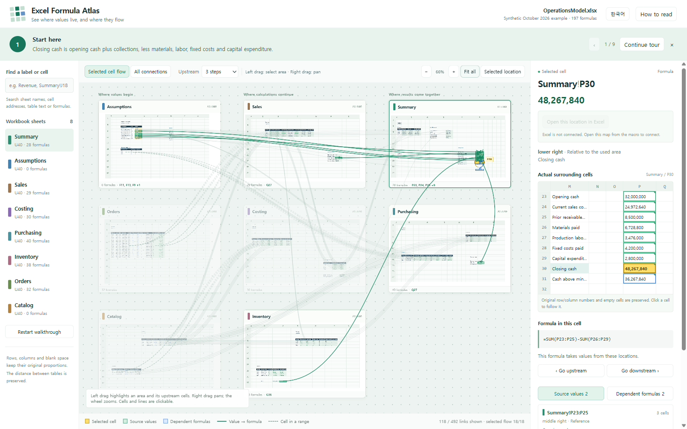
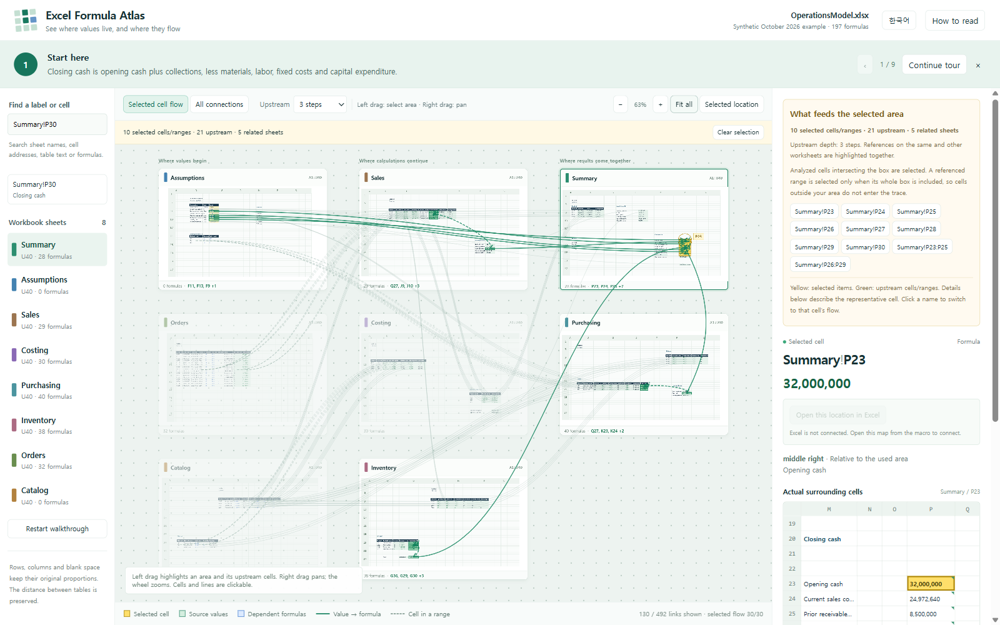

# Excel Formula Atlas

**A map for the workbook you just inherited.**

Paste one VBA module into desktop Excel and turn a workbook's formula references into an interactive HTML map. See where the cells sit on each worksheet, follow what feeds a result, and read the surrounding table without opening every sheet in turn.

[Explore the sample map](docs/demo.html) · [Download the pasteable VBA code](dist/ExcelFormulaAtlas.txt) · [Open the project page](docs/index.html)



## Why a map?

A formula such as `=SUM(Planning!F12:F30)` gives you an address. It does not tell you where that range sits in the planning sheet, which calculations feed it, or how it reaches the final report.

Excel Formula Atlas keeps those relationships in their worksheet context. The result is a starting point for understanding an unfamiliar model, investigating a surprising number, and preparing a workbook handover.

## What you can do

- **See the workbook's layout.** References appear at their actual row and column positions, alongside a snapshot of table labels, values, formatting, and blank space.
- **Trace a result.** Select a cell to highlight upstream sources and immediate downstream dependents, including references on other sheets. The trace-depth control sets how many upstream steps to follow; select a downstream formula to continue from there.
- **Select a whole area.** Drag with the left mouse button to highlight analyzed cells in the area and the upstream cells or ranges that feed them.
- **Inspect a connection.** Click a line to highlight both ends and the related flow. Focus a line and press Enter for keyboard selection.
- **Read the nearby table.** The detail panel shows the selected cell's formula, captured value, and surrounding cells.
- **Find your place.** Search for a sheet, address, or captured text; drag with the right mouse button to pan; use the wheel to zoom.
- **Follow real loading progress.** The page reports the current stage, completed work, and elapsed time while preparing the map. Large drawing tasks yield so progress can update.
- **Return to Excel.** The export attempts to start a local Windows helper that lets map selections navigate to the source workbook. The saved HTML also works as a standalone map when that connection is unavailable.
- **Switch language.** Maps start in English and include a Korean interface.



## Try it before installing

In a local copy of this repository, open [docs/index.html](docs/index.html) in your browser and launch the interactive sample, or open [the sample map](docs/demo.html) directly. The demo uses a fictional operations workbook; it does not connect to your Excel session. The project page embeds its preview, so no local web server is required.

GitHub displays repository HTML files as source until a website is configured. [PUBLISHING.md](PUBLISHING.md) describes the final steps for enabling the project page after publication.

The source workbook is included as [OperationsModel.xlsx](examples/OperationsModel.xlsx). Use it to compare the map with the actual cells, or analyze it yourself after installing the macro.

The example contains eight synthetic worksheets and 197 formulas. Start with **`Summary!P30`**, the closing-cash result. [The example notes](examples/README.md) describe its model, validation, and the provenance of the preview snapshot.

## Install with one paste

You need **desktop Microsoft Excel on Windows** and permission to run VBA macros. Excel for the web and Excel for Mac are not supported by this release. No Excel add-in, Python installation, or build tools are required to use the exported VBA code.

1. Download [ExcelFormulaAtlas.txt](dist/ExcelFormulaAtlas.txt) and open it in a text editor.
2. Open Excel. Press **Alt + F11** to open the Visual Basic editor.
3. Choose **Insert → Module**. Copy the entire TXT file and paste it into that standard module.
4. Save the workbook containing the macro as an **Excel Macro-Enabled Workbook (`.xlsm`)**, or keep the module in your existing personal macro workbook. The workbook you analyze can remain `.xlsx`.
5. Return to Excel. Press **Alt + F8**, select **`ExcelMap_Start`**, and choose **Run**.

If you are replacing an earlier version, replace the previous module's entire contents. Do not paste a second copy below it; duplicate procedure names prevent VBA from compiling.

If the workbook holding the code already has an `Auto_Close` procedure, merge the call to `FM_StopNavigation` into that procedure instead of adding another `Auto_Close`. Alternatively, install the module in a fresh macro-hosting workbook. Stop the connection before closing the code-hosting workbook or using Save As on it.

### Choose the workbook and destination

The first prompt offers two options:

| Choice | What happens |
| --- | --- |
| **1 — Current workbook** | Analyze the workbook that was active when you started the macro. |
| **2 — Choose an Excel file** | Pick an `.xlsx`, `.xlsm`, `.xlsb`, or `.xls` file in the file picker. A workbook opened for analysis is opened read-only, without updating external links or running its VBA macros. |

Next, choose a folder for the HTML map. The macro analyzes the source, saves the map, and attempts to open it with the local Excel navigation connection. If that connection cannot start, the macro reports the saved HTML path so you can open the file directly.

The TXT contains the viewer and helper code. You do not need to copy companion files to the office PC. Running the macro creates the HTML output and temporary helper files on that PC.

## Explore the map

| Action | Result |
| --- | --- |
| Click an analyzed cell | Inspect its formula and nearby table; highlight its reference flow. |
| Left-drag an area | Select analyzed cells in the area and trace what feeds them. |
| Right-drag the map | Pan without changing the selection. |
| Turn the mouse wheel | Zoom in or out around the pointer. |
| Click a connection, or focus it and press Enter | Highlight its source, target, and related flow. |
| Click a sheet heading | Focus that worksheet. |
| Use **Fit all** or press **0** | Return to the workbook overview. |
| Use **Clear selection** or press **Esc** | Clear the region or connection selection. |
| Use **+** / **−** | Zoom with the keyboard. |

**Yellow** marks selected items, **green** marks upstream sources, and **blue** marks downstream dependents. Arrows run from a source reference toward the formula that uses it. Range references appear as rectangles; dashed connections identify formula cells contained in a referenced range.

A referenced range is included in an area selection only when the whole range fits inside the selection box. This avoids tracing cells outside the area you intended to inspect.

## Loading that explains the wait

The viewer first shows a loading panel, then reports the work it completes: formula nodes, references, captured cells, worksheet geometry, map drawing, and connections. When the total is known, the percentage is calculated from completed items. Elapsed time does not advance the percentage.

Reading and parsing the embedded snapshot is an indeterminate stage. Later stages show actual counts. The percentage describes completed preparation work, rather than predicting how many seconds remain. Errors switch the panel to an explanation and a retry action.


## Local Excel navigation

The static HTML map can be opened offline. Navigating from it back to a live Excel cell uses a bundled Windows PowerShell helper and a connection on `127.0.0.1`. The helper is extracted locally when needed; you do not install a separate package.

The source workbook must still be open, and organizational Windows or browser policies may prevent the helper from starting or the browser from connecting to it. Hidden worksheets must be shown in Excel before their cells can be selected. Run **`ExcelMap_Stop`** to stop the navigation connection when you finish. The HTML map remains available.

Browser interaction tests and helper component checks cover different parts of this feature. A successful static preview does not prove that clicking the page selects a cell in a real Excel session. See [Validation status](docs/VALIDATION.md) before relying on live navigation in your environment.

## Scope and limits

This is a map of the references the analyzer can resolve, not an execution engine for Excel.

- Values and formulas are a snapshot from the time of analysis. Run the macro again after editing the source workbook.
- Dynamic references such as `INDIRECT` and some `OFFSET` formulas cannot always be resolved statically. Named ranges, structured table references, external workbooks, and other advanced reference forms require attention to the analyzer's reported limitations.
- The exporter bounds analysis to **50,000 formula cells**. Worksheet snapshots are limited to **2,000 rows**, **256 columns**, and **20,000 captured cell positions per sheet**. References outside a captured snapshot may have less surrounding context.
- The full-workbook view draws up to **700 connections** at once; the selected-flow view draws up to **200**. Select a cell or area to inspect a particular flow, and check the displayed limit notices instead of treating the visible lines as an exhaustive list.
- The worksheet snapshot does not reproduce charts, pictures, or every Excel style.
- Very large workbooks may still take time or consume substantial browser memory. Loading progress makes the work visible; it does not remove the cost of analyzing and drawing the workbook.
- A formula reference indicates that a formula mentions an input. It does not prove that every input affects the current result; conditional logic can choose a different branch.

## Your workbook data stays in the export

The analyzer runs locally in Excel; no workbook upload or cloud account is required. The viewer uses the snapshot embedded in the generated HTML and includes no third-party scripts, fonts, or analytics.

**The HTML contains captured workbook data, formulas, values, sheet names, and file metadata.** Treat it like a copy of the workbook when sharing it. The included demo and screenshots use a fictional sample.

## Development and verification

The user-facing artifact is [dist/ExcelFormulaAtlas.txt](dist/ExcelFormulaAtlas.txt). It bundles the VBA analyzer, HTML viewer, and local navigation helper into one pasteable standard module. Source files are kept separately so the distributed TXT can be rebuilt and reviewed.

From the repository root, rebuild the VBA distribution and run its static contract checks with:

```text
python scripts/build.py
python -m unittest discover -s tests -v
```

Python is a development dependency only. These checks do not start Excel or the navigation listener. The introduction page template lives in `src/site/index.html`; `scripts/build_site.py` embeds the demo and screenshots into the final `docs/index.html`.

Rebuilding the fictional Excel example is a separate, optional development task. It requires Node.js and an environment where **`@oai/artifact-tool`** is available; neither is required to paste or run the VBA macro, open the included workbook, or view the HTML map.

```text
node scripts/build_example.mjs --qa-dir <outside-repo>
```

Replace `<outside-repo>` with a QA folder outside this repository. The builder checks all 197 formula results, changes the sales-collection rate from 80% to 90% to check its effect on collections and closing cash while profit stays unchanged, restores the original input, and renders all eight sheets for review. These are artifact-engine checks; they do not establish native Excel recalculation or execution of the latest VBA analyzer. See [examples/README.md](examples/README.md) for the full rebuilding and snapshot workflow.

Changes should be checked at three levels: source and distribution consistency, real browser interactions, and real Excel macro execution. Browser success alone is not evidence of successful Excel execution or live cell navigation. [CONTRIBUTING.md](CONTRIBUTING.md) describes the checks expected for changes.

For sensitive security reports, see [SECURITY.md](SECURITY.md). For the final publication steps, see [PUBLISHING.md](PUBLISHING.md).

## Buy me a coffee

If this helped you untangle a workbook, consider [buying me a coffee](https://buymeacoffee.com/namsonghyun2). It supports the time spent improving formula coverage, testing real-world workbooks, and making the map easier to use. Optional support never unlocks features.

A useful bug report, an anonymized example, or a note about how the map helped is very welcome too.

## License

[MIT](LICENSE).
